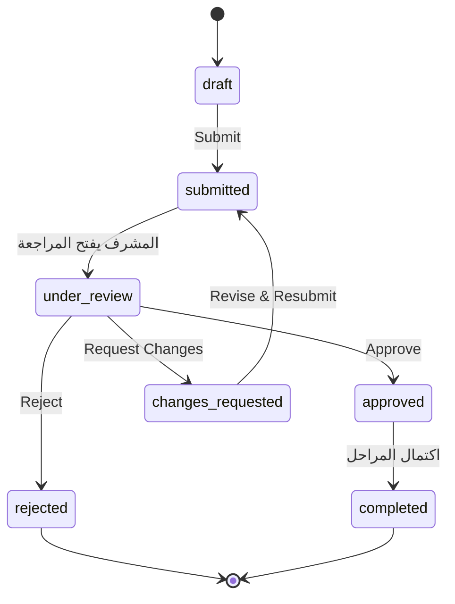
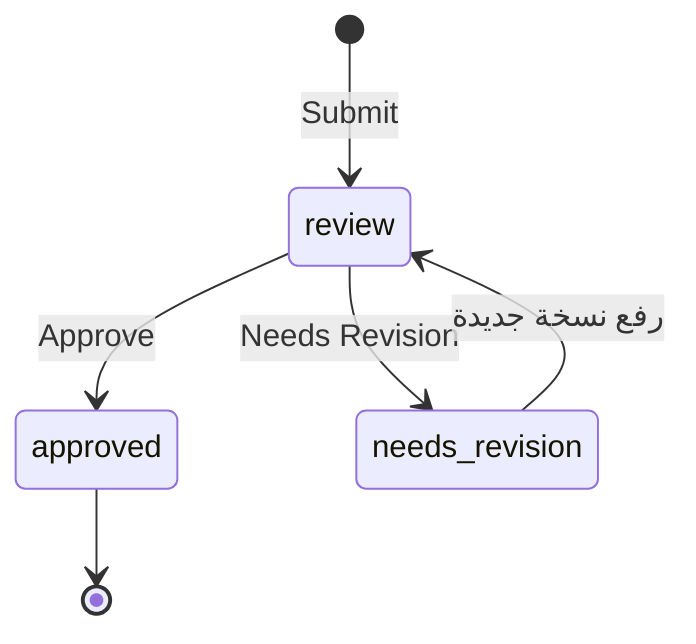
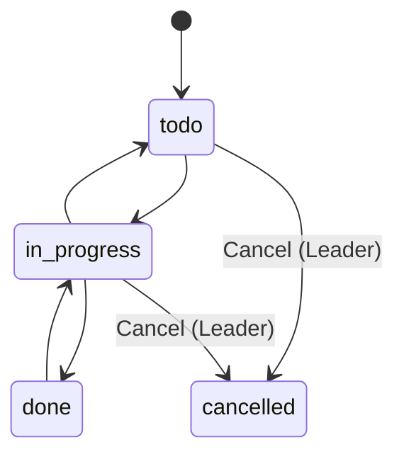
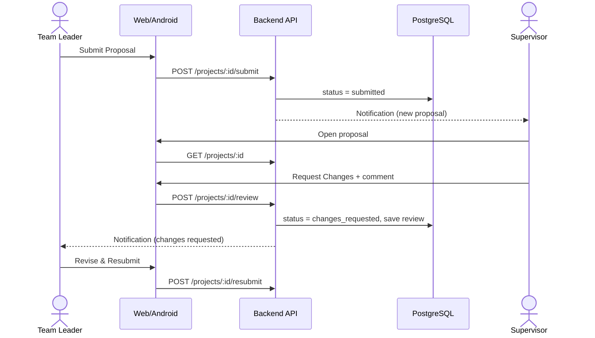
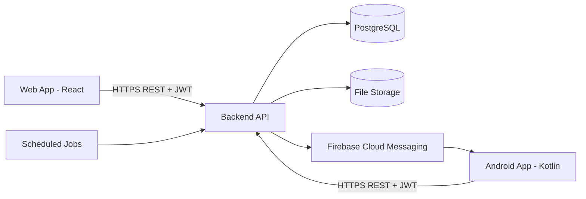
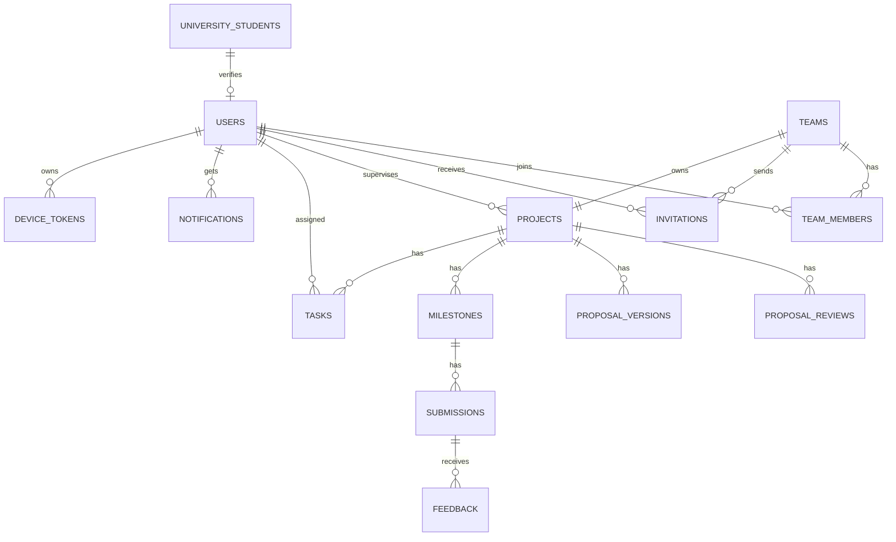
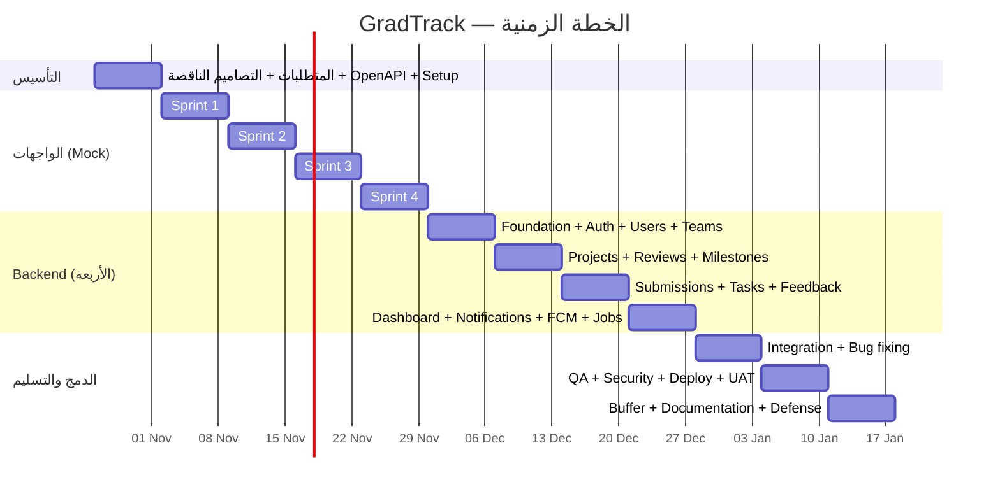

# GradTrack
## نظام إدارة ومتابعة مشاريع التخرج — Web + Android
### وثيقة مشروع التخرج (Project Documentation / SRS + SDD + Project Plan)

| البند | التفاصيل |
|---|---|
| اسم المشروع | GradTrack — Graduation Project Management |
| نوع المشروع | مشروع تخرج جامعي — هندسة برمجيات |
| المنصات | تطبيق ويب (Web) + تطبيق أندرويد (Android)، بدون iOS |
| الفريق | Malak · Wahba (Web) — Mahmoud · Ibrahim (Android) — Backend بالتعاون بين الأربعة |
| مدة التنفيذ | 12 أسبوعاً (بداية الأسبوع الذي يبدأ 26 أكتوبر 2026، النهاية ~17 يناير 2027) |
| الإصدار | 1.0 (مسودة) |
| المرجع التصميمي | ملف Figma «GradTrack — Graduation Project Management» (13 شاشة) + مخططات Use Case للأدوار الثلاثة |

> **ملاحظة:** هيكل الوثيقة يتبع القالب المعتاد لمشاريع التخرج (مقدمة ← تحليل ← تصميم ← تنفيذ ← اختبار). إن كان لدى الجامعة قالب رسمي مختلف، تُنقل الأقسام إليه كما هي.

---

# الفصل الأول: المقدمة (Introduction)

## 1.1 الملخص (Abstract)
GradTrack منصة تدعم دورة حياة مشروع التخرج الجامعي كاملة، من تكوين الفريق وتسجيل الفكرة وإرسال المقترح، مروراً بمراجعة المشرف الأكاديمي وتقسيم المهام ورفع التسليمات لكل مرحلة، وحتى المتابعة النهائية. يقدم النظام ثلاثة أدوار (طالب، قائد فريق، مشرف أكاديمي) عبر تطبيق ويب وتطبيق أندرويد يتشاركان Backend واحداً (REST API)، مع إشعارات داخلية وإشعارات Push على أندرويد.

## 1.2 المشكلة (Problem Statement)
تُدار مشاريع التخرج عادةً بوسائل غير مترابطة: رسائل واتساب وبريد إلكتروني وملفات مشتركة وجداول يدوية. ينتج عن ذلك:
1. غياب رؤية موحدة لحالة المشروع وتقدمه لدى الطالب والمشرف.
2. صعوبة تتبع ملاحظات المشرف (Feedback) وربطها بالتسليمات والنسخ.
3. ضياع المواعيد النهائية وعدم وضوح المسؤوليات داخل الفريق.
4. عبء على المشرف المسؤول عن عدة مشاريع في نفس الوقت (تجميع المقترحات والتسليمات يدوياً).
5. غياب سجل رسمي يُظهر تاريخ المقترحات والتسليمات والقرارات.

## 1.3 الأهداف (Objectives)
**الهدف العام:** توفير منصة موحدة تنظم العلاقة بين الفريق والمشرف خلال مشروع التخرج.

**الأهداف التفصيلية (قابلة للقياس):**
| # | الهدف | معيار القياس |
|---|---|---|
| O1 | رقمنة دورة المقترح (إرسال ← مراجعة ← تعديل ← قرار) | تتم الدورة كاملة داخل النظام دون وسيط خارجي |
| O2 | توحيد التسليمات والـ Feedback في مكان واحد | كل تسليم له سجل وحالة ومراجعة |
| O3 | وضوح التقدم والمواعيد | نسبة تقدم تلقائية وتنبيه قبل كل موعد |
| O4 | تقسيم المهام ومتابعتها داخل الفريق | مهام لها مسؤول وحالة وموعد |
| O5 | وصول من الويب والأندرويد بنفس البيانات والصلاحيات | تطابق وظيفي للـ Use Cases على المنصتين |
| O6 | أمان الصلاحيات | لا يصل مستخدم لبيانات لا تخصه (اختبارات RBAC ناجحة 100%) |

## 1.4 النطاق (Scope)
**داخل النطاق:**
- حسابات الطلاب (تسجيل + تحقق من الرقم الجامعي) وحسابات المشرفين (تُنشأ مسبقاً).
- الفرق والدعوات، تسجيل المشروع والمقترح وإعادة الإرسال.
- مراجعة المقترح، المراحل الخمس، التسليمات ومراجعتها، المهام، التقدم، لوحات المعلومات، الإشعارات، الملف الشخصي.

**خارج النطاق (إصدار لاحق):** iOS، لوحة Admin، محادثة مباشرة، تسجيل دخول موحد مع نظام الجامعة (SSO)، تحليلات متقدمة، دعم لغات متعددة (الواجهة بالإنجليزية مع الاستعداد لـ RTL).

## 1.5 الجهات المعنية (Stakeholders)
| الجهة | الاهتمام |
|---|---|
| الطلاب / قادة الفرق | تنظيم العمل ومعرفة حالة المقترح والتسليمات |
| المشرفون الأكاديميون | مراجعة سريعة ومنظمة لعدة مشاريع |
| الجامعة / القسم (جهة غير مباشرة) | سجل موثق للمشاريع (قد تُضاف لاحقاً لوحة Admin) |
| فريق التطوير | تسليم المشروع في الوقت المحدد بجودة عالية |

## 1.6 مقارنة مع الحلول القائمة (مقارنة نوعية)
| الأداة (عامة الاستخدام) | ما تقدمه | الفجوة بالنسبة لمشاريع التخرج |
|---|---|---|
| Trello / Jira / Asana | إدارة مهام وLists | لا يوجد مفهوم مقترح ومراجعة رسمية ولا مراحل تخرج ولا دور مشرف أكاديمي |
| Google Classroom / Moodle | تسليم واجبات | موجهة للمقررات لا لمشروع فريق متعدد المراحل مع مقترح وفريق وإسناد مهام |
| WhatsApp / Email | تواصل | لا تنظيم ولا سجل ولا تتبع حالة |

**القيمة المضافة:** نظام مصمم خصيصاً لسير عمل مشروع التخرج بصلاحيات ومراحل محددة سلفاً.

## 1.7 التعريفات والاختصارات
| المصطلح | المعنى |
|---|---|
| Proposal | مقترح المشروع المرسل للمشرف |
| Milestone | مرحلة من مراحل المشروع الخمس |
| Deliverable / Submission | ملف يسلَّم لمرحلة معينة |
| RBAC | Role-Based Access Control |
| JWT | JSON Web Token |
| FCM | Firebase Cloud Messaging |
| MVP | النسخة الأدنى القابلة للتسليم |
| UC / FR / NFR | Use Case / Functional Req. / Non-Functional Req. |

---

# الفصل الثاني: تحليل المتطلبات (Requirements Analysis)

## 2.1 الأدوار (Actors)
| الدور | الوصف | كيف يُنشأ |
|---|---|---|
| **Student** | طالب عضو في فريق | تسجيل ذاتي مع التحقق من الرقم الجامعي |
| **Team Leader** | الطالب الذي أنشأ الفريق، ويملك صلاحيات إدارة الفريق والمشروع | أي طالب موثّق ينفذ Create Team (الدور مرتبط بالفريق لا بالحساب) |
| **Academic Supervisor** | يراجع المقترحات والتسليمات ويقدم Feedback | حساب يُنشأ مسبقاً بالـ Seed/Script (لا تسجيل ذاتي) |

## 2.2 مصفوفة Use Cases والصلاحيات (المرجع الرسمي)
| UC | Student | Leader | Supervisor |
|---|:-:|:-:|:-:|
| Register Account | ✅ | — | — |
| Verify University ID | ✅ | — | — |
| Log In / Log Out | ✅ | ✅ | ✅ |
| Recover Password | ✅ | ✅ | ✅ |
| View Dashboard | ✅ | ✅ | ✅ |
| Manage Profile | ✅ | ✅ | ✅ |
| View Notifications | ✅ | ✅ | ✅ |
| View Team Details | ✅ | ✅ | — |
| View Invitations / Respond to Invitation | ✅ | — | — |
| Create Team | — | ✅ | — |
| Send Team Invitation | — | ✅ | — |
| Remove Team Member | — | ✅ | — |
| Register Graduation Project | — | ✅ | — |
| Update Project Information | — | ✅ | — |
| Submit Project Proposal | — | ✅ | — |
| Revise and Resubmit Proposal | — | ✅ | — |
| View Proposal Status | ✅ | ✅ | — |
| Create Task / Assign Task | — | ✅ | — |
| Edit or Cancel Task | — | ✅ | — |
| View Assigned Tasks / Task Details | ✅ | ✅ | — |
| Update Own Task Status | ✅ | ✅ | — |
| View Project Progress | ✅ | ✅ | ✅ |
| Submit Project Deliverable | — | ✅ | — |
| View Submission History | ✅ | ✅ | ✅ |
| View Feedback | ✅ | ✅ | — |
| View Project Details | — | ✅ | ✅ |
| View Submission Details | — | ✅ | ✅ |
| Review Project Proposal | — | — | ✅ |
| Review Project Deliverable | — | — | ✅ |
| Provide Feedback | — | — | ✅ |

> الخلايا «—» تعني أن الـ Use Case غير مرسوم للدور في المخطط. يُعامل القائد كطالب في الميزات المشتركة (عرض المهام، تحديث مهمته، عرض Feedback). يجب تأكيد هذه النقطة مع المشرف الأكاديمي للمشروع.

## 2.3 المتطلبات الوظيفية (Functional Requirements)

### الوحدة A — المصادقة والحساب (Auth)
| ID | المتطلب | الأولوية |
|---|---|---|
| FR-A1 | يسجل الطالب بالرقم الجامعي والبريد وكلمة المرور | عالية |
| FR-A2 | يتحقق النظام من وجود الرقم الجامعي في قائمة طلاب الجامعة قبل إنشاء الحساب | عالية |
| FR-A3 | تسجيل الدخول بالرقم الجامعي (طالب) أو البريد (مشرف) وكلمة المرور | عالية |
| FR-A4 | تسجيل الخروج وإبطال الـ Refresh Token | عالية |
| FR-A5 | استعادة كلمة المرور عبر رابط/رمز يرسل للبريد وينتهي خلال مدة محددة | عالية |
| FR-A6 | تطبيق RBAC على كل Endpoint | عالية |
| FR-A7 | تعديل البيانات الشخصية وتغيير كلمة المرور | متوسطة |

### الوحدة B — الفرق والدعوات (Team)
| ID | المتطلب | الأولوية |
|---|---|---|
| FR-T1 | ينشئ الطالب فريقاً فيصبح Team Leader له (طالب لا ينتمي لفريق آخر) | عالية |
| FR-T2 | عرض تفاصيل الفريق (الأعضاء، الأدوار، الحالة، المشرف) | عالية |
| FR-T3 | يرسل القائد دعوة لطالب موثّق (بالرقم الجامعي أو البريد) | عالية |
| FR-T4 | يعرض الطالب الدعوات الواردة ويقبل أو يرفض | عالية |
| FR-T5 | يزيل القائد عضواً من الفريق (مع إشعار له) | عالية |
| FR-T6 | حد أقصى لعدد الأعضاء قابل للضبط (افتراضي 4) | متوسطة |

### الوحدة C — المشروع والمقترح (Project & Proposal)
| ID | المتطلب | الأولوية |
|---|---|---|
| FR-P1 | يسجل القائد المشروع: العنوان، التصنيف، المشكلة، الأهداف، التقنيات، المدة، ملف PDF، واختيار المشرف | عالية |
| FR-P2 | حفظ المشروع كمسودة (Draft) قبل الإرسال | متوسطة |
| FR-P3 | تعديل بيانات المشروع قبل الإرسال أو عند طلب التعديل | عالية |
| FR-P4 | إرسال المقترح للمشرف (Submit) ولا يمكن تعديله أثناء المراجعة | عالية |
| FR-P5 | عرض حالة المقترح وخط زمني للمراجعة (Draft ← Submitted ← Under Review ← Decision) | عالية |
| FR-P6 | إعادة الإرسال بعد طلب التعديل (Revise & Resubmit) مع حفظ النسخ السابقة | عالية |
| FR-P7 | عرض تفاصيل المشروع للقائد والمشرف | عالية |

### الوحدة D — مراجعة المشرف (Supervisor Review)
| ID | المتطلب | الأولوية |
|---|---|---|
| FR-R1 | قائمة المقترحات المسندة للمشرف مع فلترة بالحالة | عالية |
| FR-R2 | القرار على المقترح: Approve / Request Changes / Reject مع تعليق (إلزامي عند التعديل والرفض) | عالية |
| FR-R3 | كتابة Feedback وعرضه للفريق مع إمكانية الرد | عالية |
| FR-R4 | عند Approve: تُنشأ المراحل الخمس للمشروع تلقائياً بمواعيدها | عالية |

### الوحدة E — المراحل والتسليمات (Milestones & Submissions)
| ID | المتطلب | الأولوية |
|---|---|---|
| FR-M1 | عرض المراحل الخمس بحالاتها ومواعيدها | عالية |
| FR-M2 | حساب نسبة التقدم تلقائياً من المراحل المعتمدة | عالية |
| FR-S1 | يرفع القائد تسليماً لمرحلة (PDF/ZIP/صور، حتى 25MB) | عالية |
| FR-S2 | سجل التسليمات لكل مرحلة (النسخ والتواريخ والحالات) | عالية |
| FR-S3 | تفاصيل التسليم (ملف، مرسِل، مراجِع، حالة، Feedback) | عالية |
| FR-S4 | يراجع المشرف التسليم: Approved / Needs Revision مع Feedback | عالية |
| FR-S5 | رفع نسخة جديدة بعد Needs Revision (مع حفظ القديمة) | عالية |

### الوحدة F — المهام (Tasks)
| ID | المتطلب | الأولوية |
|---|---|---|
| FR-K1 | ينشئ القائد مهمة (العنوان، الوصف، الموعد) ويسندها لعضو | عالية |
| FR-K2 | تعديل المهمة أو إلغاؤها (القائد) | عالية |
| FR-K3 | عرض المهام المسندة للمستخدم وتفاصيل المهمة | عالية |
| FR-K4 | يحدّث العضو حالة **مهمته فقط**: To Do / In Progress / Done | عالية |
| FR-K5 | لوحة مهام الفريق مع إحصائيات | متوسطة |

### الوحدة G — اللوحات والإشعارات
| ID | المتطلب | الأولوية |
|---|---|---|
| FR-D1 | Dashboard للطالب/القائد: التقدم، المواعيد، Feedback، الفريق، النشاط الأخير | عالية |
| FR-D2 | Dashboard للمشرف: المشاريع النشطة، المقترحات المعلقة، التسليمات، المواعيد | عالية |
| FR-N1 | إشعارات داخلية مصنفة (Proposal, Feedback, Deadline, Team, Task, Submission) مع Mark as read | عالية |
| FR-N2 | Push Notifications على أندرويد | متوسطة |
| FR-N3 | تنبيه آلي قبل الموعد النهائي بـ 3 أيام و1 يوم | متوسطة |

## 2.4 المتطلبات غير الوظيفية (Non-Functional)
| ID | الفئة | المتطلب | طريقة التحقق |
|---|---|---|---|
| NFR-1 | الأمان | تخزين كلمات المرور بـ bcrypt/argon2؛ JWT قصير العمر + Refresh Token؛ HTTPS إلزامي | مراجعة كود + اختبار |
| NFR-2 | الأمان | فحص الصلاحيات في الـ Backend لكل طلب (وليس في الواجهة فقط) | اختبار RBAC آلي |
| NFR-3 | الأمان | التحقق من المدخلات (Validation)، حماية من SQL Injection وXSS، Rate limiting على الدخول والاستعادة | اختبار |
| NFR-4 | الملفات | قبول الأنواع PDF/ZIP/PNG/JPG فقط، ≤ 25MB، فحص الحجم والنوع في الخادم | اختبار |
| NFR-5 | الأداء | زمن استجابة API العادي ≤ 500ms عند 100 مستخدم متزامن | اختبار تحميل (k6/Artillery) |
| NFR-6 | التوافق | Web: آخر نسختين من Chrome/Edge/Firefox/Safari؛ Android: 8.0 (API 26) فما فوق | اختبار على الأجهزة |
| NFR-7 | سهولة الاستخدام | واجهة متناسقة مع Figma، Responsive، حالات Empty/Loading/Error لكل شاشة | مراجعة تصميم |
| NFR-8 | الاعتمادية | نسخ احتياطي يومي لقاعدة البيانات؛ معالجة الأخطاء برسائل واضحة | فحص |
| NFR-9 | الصيانة | الكود بمعايير Lint، التوثيق بـ OpenAPI، تغطية اختبارات ≥ 60% للمنطق الحرج | CI |
| NFR-10 | التوسع | تصميم API بحيث يمكن إضافة iOS أو Admin لاحقاً دون تغيير الـ Backend | مراجعة معمارية |
| NFR-11 | الخصوصية | يرى المستخدم بيانات فريقه ومشروعه فقط | اختبار RBAC |

## 2.5 قواعد العمل (Business Rules)
| ID | القاعدة |
|---|---|
| BR-1 | الطالب ينتمي لفريق واحد فقط في الفصل الواحد. |
| BR-2 | لكل فريق مشروع واحد ومشرف واحد. |
| BR-3 | لا يُرسل المقترح قبل اكتمال الحقول الإلزامية ورفع الملف. |
| BR-4 | لا يعدّل الفريق المقترح أثناء `under_review`. |
| BR-5 | Request Changes وReject يتطلبان تعليقاً. |
| BR-6 | التقدم = (عدد المراحل المعتمدة ÷ 5) × 100، ويمكن لاحقاً دمج المهام بوزن. |
| BR-7 | المرحلة تُعتمد عندما يُعتمد (Approved) آخر تسليم مطلوب لها. |
| BR-8 | الدعوة تنتهي صلاحيتها بعد 7 أيام وتُلغى عند انضمام الطالب لفريق آخر. |
| BR-9 | لا يحذف النظام التسليمات القديمة؛ كل رفع نسخة جديدة. |
| BR-10 | مواعيد المراحل تأتي من إعدادات الفصل (Config) وليس من المشرف في هذه النسخة. |

---

# الفصل الثالث: تحليل النظام (System Analysis)

## 3.1 مواصفات Use Cases الأساسية

### UC-01: Register Account
| الحقل | التفصيل |
|---|---|
| الفاعل | Student (غير مسجل) |
| الشرط المسبق | الرقم الجامعي موجود في `university_students` ولا يوجد حساب به |
| التدفق الأساسي | 1) يدخل الرقم الجامعي والبريد وكلمة المرور ← 2) يتحقق النظام من الرقم الجامعي ← 3) يُنشئ الحساب ← 4) يوجه للدخول |
| تدفقات بديلة | رقم غير موجود ← رسالة خطأ؛ رقم مستخدم ← «الحساب موجود»؛ كلمة مرور ضعيفة ← رفض |
| الشرط اللاحق | حساب مفعّل بدور student |

### UC-02: Create Team + Send Invitation
| الحقل | التفصيل |
|---|---|
| الفاعل | Student ← يصبح Team Leader |
| الشرط المسبق | الطالب موثّق ولا ينتمي لفريق |
| التدفق الأساسي | 1) Create Team باسم ← 2) يصبح Leader ← 3) يرسل دعوات (رقم جامعي/بريد) ← 4) يصل الإشعار للمدعو |
| تدفقات بديلة | المدعو في فريق آخر ← رفض؛ بلوغ الحد الأقصى ← رفض؛ دعوة مكررة ← رفض |
| الشرط اللاحق | دعوة بحالة `pending` وإشعار مرسل |

### UC-03: Respond to Invitation
| الحقل | التفصيل |
|---|---|
| الفاعل | Student |
| التدفق الأساسي | يفتح قائمة الدعوات ← يقبل ← يُضاف عضواً (`active`) ← تُلغى باقي دعواته ← إشعار للقائد |
| بديل | يرفض ← الدعوة `declined` ← إشعار للقائد |
| بديل | الدعوة منتهية ← رسالة وإخفاء الأزرار |

### UC-04: Register Project & Submit Proposal
| الحقل | التفصيل |
|---|---|
| الفاعل | Team Leader |
| الشرط المسبق | فريق قائم، لا مشروع للفريق |
| التدفق الأساسي | Wizard: 1) معلومات المشروع ← 2) مراجعة الأعضاء واختيار المشرف ← 3) مراجعة وإرسال (Submit) ← الحالة `submitted` ← إشعار للمشرف |
| بديل | حفظ كمسودة والإكمال لاحقاً |
| بديل | حقل ناقص أو ملف غير مسموح ← رفض مع رسالة |
| الشرط اللاحق | المقترح بحالة `submitted` ومقفل للتعديل |

### UC-05: Review Project Proposal
| الحقل | التفصيل |
|---|---|
| الفاعل | Academic Supervisor |
| الشرط المسبق | مقترح بحالة `submitted` أو `under_review` مسند للمشرف |
| التدفق الأساسي | يفتح المقترح ← الحالة تصبح `under_review` ← يقرأ التفاصيل والفريق والمستند ← يختار قراراً ← يكتب تعليقاً ← يؤكد |
| النتائج | **Approve**: `approved` + إنشاء المراحل. **Request Changes**: `changes_requested`. **Reject**: `rejected`. وإشعار للفريق في كل الحالات |
| بديل | لا تعليق في Changes/Reject ← رفض الإرسال |

### UC-06: Revise and Resubmit Proposal
القائد يعدّل بيانات المشروع/المستند ثم يعيد الإرسال ← الحالة `submitted` وتُحفظ النسخة السابقة مع تعليق المشرف ← إشعار للمشرف.

### UC-07: Submit Project Deliverable
| الحقل | التفصيل |
|---|---|
| الفاعل | Team Leader |
| الشرط المسبق | المشروع `approved` والمرحلة `in_progress` |
| التدفق الأساسي | يختار المرحلة ← يرفع ملفاً ← يضيف وصفاً ← الحالة `review` ← إشعار للمشرف |
| بديل | نوع/حجم غير مسموح ← رفض |
| بديل | بعد Needs Revision ← رفع نسخة جديدة |

### UC-08: Review Project Deliverable & Provide Feedback
المشرف يفتح تفاصيل التسليم ← يحمّل الملف ← يختار Approved أو Needs Revision ← يكتب Feedback ← إشعار للفريق ← عند Approved لآخر تسليم في المرحلة تُعتمد المرحلة ويتحدث التقدم.

### UC-09: Create / Assign / Edit / Cancel Task
القائد ينشئ مهمة ويسندها لعضو نشط ← إشعار للعضو ← العضو يحدّث حالتها فقط ← القائد يعدل أو يلغي (`cancelled`) ← إشعار.

## 3.2 مخططات الحالة (State Machines)

**المقترح / المشروع:**

**التسليم:**

**المهمة:**

**الدعوة:** `pending → accepted | declined | expired | cancelled`

## 3.3 مخطط التسلسل (دورة المقترح)

---

# الفصل الرابع: تصميم النظام (System Design)

## 4.1 المعمارية العامة

**نمط المعمارية:** Client–Server، API مستقل بطبقات (Controller ← Service ← Repository)، وعميلان (Web وAndroid) يستهلكان نفس العقد (OpenAPI).

## 4.2 التقنيات المقترحة
| الطبقة | الاختيار | المبرر |
|---|---|---|
| Backend | **NestJS (TypeScript) + Prisma + PostgreSQL** | يوافق لغة الويب (TypeScript)، Guards جاهزة لـ RBAC، توليد OpenAPI تلقائي. *البديل: Spring Boot/Ktor (Kotlin) إن كان الفريق أقوى بها* |
| Web | React + TypeScript + Vite + Tailwind + React Query | سرعة بناء، مطابقة Figma |
| Android | Kotlin + Jetpack Compose + MVVM + Hilt + Retrofit + Room(اختياري) | معيار أندرويد الحديث |
| Auth | JWT + Refresh، bcrypt/argon2 | |
| Push | FCM | أندرويد فقط |
| Storage | قرص الخادم/S3 متوافق (MinIO) | |
| Mock أثناء الواجهات | Web: **MSW (Mock Service Worker)** — Android: Fake Repository عبر Hilt أو MockWebServer | استبدال الـ Mock بالـ API بدون تعديل الشاشات |
| Deploy | Docker Compose (API + Postgres + Nginx) على VPS أو Railway/Render | |
| CI | GitHub Actions: Lint + Test + Build | |

> **قرار يحسمه الفريق في الأسبوع 1:** لغة الـ Backend. التوصية NestJS لأن Malak وWahba يعملان بـ TypeScript بالفعل.

## 4.3 نموذج البيانات (ERD)

### الجداول الرئيسية
| الجدول | الحقول الأساسية |
|---|---|
| `university_students` | university_id (PK)، full_name، email، department |
| `users` | id، university_id، email، password_hash، full_name، department، academic_year، system_role (student/supervisor)، is_verified |
| `teams` | id، name، leader_id، max_members، semester |
| `team_members` | team_id، user_id، role (leader/member)، status (active/removed) |
| `invitations` | id، team_id، invited_user_id، status، expires_at |
| `projects` | id، team_id، supervisor_id، title، category، problem_statement، objectives، technologies[]، duration_months، status، progress_pct |
| `proposal_versions` | id، project_id، version_no، snapshot (JSON)، file_url، submitted_at |
| `proposal_reviews` | id، project_id، version_no، supervisor_id، decision، comment، created_at |
| `milestones` | id، project_id، stage، due_date، status، order |
| `submissions` | id، milestone_id، submitted_by، version_no، file_url، file_name، status، reviewer_id، submitted_at |
| `feedback` | id، project_id، submission_id?، author_id، body، reply_to?، created_at |
| `tasks` | id، project_id، title، description، assignee_id، status، due_date، created_by |
| `notifications` | id، user_id، type، title، body، ref_type، ref_id، is_read، created_at |
| `device_tokens` | id، user_id، fcm_token |

## 4.4 تصميم الـ API (REST)
**قواعد عامة:** Base `/api/v1`، JSON، ترقيم الصفحات `?page&limit`، رمز الحالة القياسي، صيغة خطأ موحدة `{ "error": { "code", "message", "details" } }`، مصادقة `Authorization: Bearer <JWT>`.

| الوحدة | Endpoints | الأدوار |
|---|---|---|
| Auth | `POST /auth/register` · `/auth/verify-university-id` · `/auth/login` · `/auth/refresh` · `/auth/logout` · `/auth/forgot-password` · `/auth/reset-password` | عام |
| Users | `GET/PATCH /me` · `PATCH /me/password` | الكل |
| Teams | `POST /teams` · `GET /teams/me` · `POST /teams/:id/invitations` · `DELETE /teams/:id/members/:userId` | Student/Leader |
| Invitations | `GET /invitations` · `POST /invitations/:id/accept` · `/decline` | Student |
| Projects | `POST /projects` · `PATCH /projects/:id` · `GET /projects/:id` · `POST /projects/:id/submit` · `POST /projects/:id/resubmit` | Leader (+Supervisor للقراءة) |
| Reviews | `GET /supervisor/proposals` · `POST /projects/:id/review` | Supervisor |
| Milestones | `GET /projects/:id/milestones` · `GET /projects/:id/progress` | الكل (المصرح) |
| Submissions | `POST /milestones/:id/submissions` · `GET /projects/:id/submissions` · `GET /submissions/:id` · `POST /submissions/:id/review` | Leader/Supervisor |
| Feedback | `GET /projects/:id/feedback` · `POST /feedback` | حسب المصفوفة |
| Tasks | `POST /projects/:id/tasks` · `GET /tasks/mine` · `GET /tasks/:id` · `PATCH /tasks/:id` · `PATCH /tasks/:id/status` | Leader/Student |
| Dashboard | `GET /dashboard` | الكل (يتغير حسب الدور) |
| Notifications | `GET /notifications` · `POST /notifications/read-all` · `PATCH /notifications/:id/read` · `POST /devices` | الكل |

## 4.5 تصميم الأمان
- **المصادقة:** Access Token (15 دقيقة) + Refresh Token (7 أيام) قابل للإبطال.
- **التفويض:** Guard بدورين: `system_role` + دور العضوية في الفريق (leader/member) + ملكية المورد (Resource ownership).
- **الملفات:** رفع عبر الـ API فقط، أسماء عشوائية، الوصول بتحقق من الصلاحية (لا روابط عامة).
- **الحماية العامة:** Helmet، CORS مضبوط، Rate limiting، Validation (DTO/Zod)، سجل تدقيق للقرارات والمراجعات.

## 4.6 تصميم الواجهات (UI/UX)
**الهوية:** خلفية `#F8F4EA`، أخضر غامق للـ Sidebar (~`#26453A`)، أزرار أخضر (~`#3B6B52`)، خط Inter، بطاقات مدورة، Status pills، Stepper، Progress bars.

| شاشات Figma الموجودة (13) | Login · Student Dashboard · Register Project · Project Details & Progress · Supervisor Dashboard · Milestones & Submissions · Team Management · Proposal Status · Proposal Review · Submission Review · Tasks · Notifications · Profile & Settings |
|---|---|

**شاشات ناقصة يجب تصميمها (الأسبوع 1):**
1. Register Account + Verify University ID، وForgot/Reset Password.
2. Create Team، وInvitations (قائمة + Accept/Decline).
3. Add/Edit/Cancel Task، وTask Details.
4. Upload Deliverable، وSubmission Details (Review + Feedback).
5. Revise & Resubmit Proposal.
6. حالات Empty / Loading / Error.
7. **تخطيط Android الكامل** (Figma كله Desktop): Bottom Navigation، الجداول إلى Cards، Wizard خطوة بخطوة.

**استراتيجية التجاوب:**
| العرض | التخطيط |
|---|---|
| Web ≥ 1024 | Sidebar ثابت كما في Figma |
| Web 600–1023 | Sidebar مطوي |
| Android | Bottom Nav (4–5 عناصر) + More، الجداول Cards |

**قائمة التنقل لكل دور:**
- Student: Dashboard · My Team · Invitations · Tasks · Proposal Status · Milestones · Submissions · Notifications · Profile
- Leader: Student + Register Project · Team Management · Submit Deliverable
- Supervisor: Dashboard · Proposal Reviews · Submission Reviews · Feedback · Notifications · Profile

## 4.7 قرارات تصميمية وتعارضات مع Figma
| # | التعارض | القرار |
|---|---|---|
| 1 | Figma فيه Create account للقائد والمشرف | تسجيل للطلاب فقط، والمشرف بـ Seed |
| 2 | كيف يصبح الطالب Leader | بإنشاء فريق (الدور على مستوى الفريق) |
| 3 | Milestone Management للمشرف | يُحذف من هذه النسخة (لا Use Case له) |
| 4 | 5 أو 6 مراحل | 5 مراحل ثابتة |
| 5 | تناقض اسم المشرف/نسبة التقدم في الأمثلة | بيانات مثال فقط، النسبة تحسب آلياً |
| 6 | التحقق من الرقم الجامعي | جدول `university_students` من CSV أو Seed |

---

# الفصل الخامس: خطة التنفيذ (Implementation Plan)

## 5.1 منهجية العمل
**Agile بسبرنتات أسبوعية** مع تسليم Demo في نهاية كل مرحلة. وترتيب التنفيذ **Frontend أولاً على بيانات تجريبية، ثم Backend بمشاركة الأربعة**.

**لماذا ينجح هذا الترتيب؟**
- التصاميم والتجربة تُختبر مع المشرف الأكاديمي مبكراً قبل بناء الـ Backend.
- يُكتب عقد الـ API (OpenAPI) **في الأسبوع الأول** ويُبنى الـ Mock عليه، فلا يتغير شكل الاستدعاءات لاحقاً.

**كيف نتجنب مشاكل «الواجهة أولاً»؟**
| الخطر | المعالجة |
|---|---|
| اختلاف الـ API الحقيقي عن الـ Mock | الـ Mock يُولَّد من OpenAPI، وأي تغيير في العقد يمر بمراجعة الأربعة |
| ربط الشاشات بالـ Mock مباشرة | طبقة Repository/API Client معزولة: الشاشات لا تعرف مصدر البيانات |
| تكرار العمل عند التبديل | MSW على الويب وFake Repository على أندرويد يستبدلان بإعداد واحد (Flag) |
| منطق الصلاحيات يُكتب في الواجهة فقط | تُكتب قواعد الصلاحيات في الـ Backend وتُخفى العناصر في الواجهة فقط لتحسين الاستخدام |

## 5.2 توزيع الفريق
| العضو | المنصة | المسؤولية في مرحلة الواجهات |
|---|---|---|
| **Malak** | Web | Auth، Profile، Team، Invitations، Register Project، Proposal Status |
| **Wahba** | Web | Dashboards، Supervisor flows (Proposal Review، Submission Review)، Milestones، Submissions، Tasks، Notifications |
| **Mahmoud** | Android | Auth، Profile، Team، Invitations، Register Project، Proposal Status |
| **Ibrahim** | Android | Dashboards، Supervisor flows، Milestones، Submissions، Tasks، Notifications |

> كل زوج يتبادل مراجعة الكود (Malak↔Wahba، Mahmoud↔Ibrahim)، والمطابقة بين المنصتين تراجع في نهاية كل سبرنت.

**توزيع الـ Backend (الأسابيع 6–9)** — زوجان مختلطان (واحد ويب + واحد أندرويد) لأن كل شخص سيستهلك ما يبنيه:
| الزوج | الوحدات |
|---|---|
| **Malak + Mahmoud** | Auth، Users، Teams، Invitations، Tasks، Notifications + FCM + Jobs |
| **Wahba + Ibrahim** | Projects، Proposal Reviews، Milestones & Progress، Submissions & Files، Feedback، Dashboard، Deploy |

## 5.3 الجدول الزمني (12 أسبوعاً)

### تفصيل الأسابيع
| الأسبوع | المرحلة | الأعمال | المخرج / معيار الإنجاز |
|---|---|---|---|
| **1** | تأسيس | اعتماد المتطلبات وقرارات القسم 4.7؛ تصميم الشاشات الناقصة (Web: Malak+Wahba، Android: Mahmoud+Ibrahim)؛ Repos وCI؛ **كتابة OpenAPI كاملة**؛ Design System (Tokens)؛ قرار لغة الـ Backend | عقد API معتمد + تصاميم كاملة + مشاريع تعمل بشاشة فارغة |
| **2** | واجهات 1 | Auth، Profile، Team، Invitations (على Mock) | رحلة التسجيل والفريق تعمل على المنصتين |
| **3** | واجهات 2 | Register Project Wizard، Proposal Status، Supervisor Dashboard، Proposal Review | **Demo 1 للمشرف الأكاديمي**: رحلة المقترح كاملة بـ Mock |
| **4** | واجهات 3 | Milestones، Upload، Submission History/Details، Submission Review، Tasks | رحلة التسليم والمهام تعمل |
| **5** | واجهات 4 | Dashboards، Notifications، Empty/Loading/Error، Responsive، مراجعة المطابقة بين Web وAndroid | **Frontend Freeze** — كل الشاشات مكتملة على Mock |
| **6** | Backend 1 | Setup (NestJS، DB، Prisma، Docker)، Auth + RBAC + Users، Teams، Invitations؛ التبديل الأول من Mock إلى API | تسجيل/دخول/فريق حقيقي على Web وAndroid |
| **7** | Backend 2 | Projects، Proposal versions/reviews، Milestones/Progress، رفع PDF | دورة المقترح الحقيقية — **Demo 2** |
| **8** | Backend 3 | Submissions، Feedback، Tasks | دورة التسليم والمهام الحقيقية |
| **9** | Backend 4 | Dashboard، Notifications، FCM، Deadline Job | **Backend Freeze** — كل الـ Endpoints جاهزة |
| **10** | دمج | إكمال التبديل من Mock إلى API في كل الوحدات، إصلاح الأخطاء، مطابقة السلوك | كل Use Cases تعمل End-to-end |
| **11** | جودة | اختبارات RBAC شاملة، اختبار تحميل، Security review، اختبار على أجهزة حقيقية، نشر Production، UAT مع مشرف حقيقي | نسخة منشورة وAPK موقّع |
| **12** | Buffer + توثيق | إصلاحات متأخرة، توثيق نهائي، التقرير، Slides، بروفة المناقشة | جاهزون للتسليم |

### نقاط التحكم (Milestones)
| # | الموعد | المخرج |
|---|---|---|
| M1 | نهاية أسبوع 1 | تصاميم كاملة + OpenAPI معتمد |
| M2 | نهاية أسبوع 3 | Demo 1 (واجهات رحلة المقترح) |
| M3 | نهاية أسبوع 5 | Frontend Freeze |
| M4 | نهاية أسبوع 7 | أول رحلة حقيقية End-to-end |
| M5 | نهاية أسبوع 9 | Backend Freeze |
| M6 | نهاية أسبوع 11 | نسخة Production + UAT |
| M7 | نهاية أسبوع 12 | التسليم والمناقشة |

> **تنبيه للجدولة:** الـ Buffer الحقيقي قصير (جزء من أسبوع 11 وأسبوع 12). لذلك: (1) لا Nice-to-have قبل M5، (2) أي تأخر في الواجهات يُعالج بتقليل تلميع الشاشات وليس بتأخير بداية الـ Backend، (3) الـ Backend يُبنى بترتيب يطابق أولوية الرحلات.

## 5.4 إدارة المخاطر
| # | الخطر | الاحتمال | الأثر | المعالجة |
|---|---|---|---|---|
| R1 | خبرة الفريق في Backend أقل من الواجهات | متوسط | عالي | اختيار Stack قريب من خبرتهم (TypeScript)، Boilerplate جاهز، جلسة تدريب في أسبوع 5 |
| R2 | تغيير العقد بعد بناء الواجهات | عالي | متوسط | OpenAPI مبكر + مراجعة جماعية للتغيير |
| R3 | تأخر استكمال التصاميم | متوسط | عالي | تُنجز في أسبوع 1 بالتوازي مع الإعداد؛ تكتفى بالحد الأدنى للشاشات الثانوية |
| R4 | اختلاف سلوك Web وAndroid | متوسط | متوسط | قائمة سلوك مشتركة (Acceptance Criteria لكل Use Case) ومراجعة نهاية كل سبرنت |
| R5 | ضغط امتحانات/مقررات أخرى | عالي | عالي | تخطيط 20–25 ساعة/أسبوع لكل عضو، والـ Buffer لا يُستهلك مبكراً |
| R6 | صعوبة رفع الملفات والأمان فيها | متوسط | متوسط | استخدام حل جاهز (Multer + قيود صارمة) وتأجيل المعاينة داخل التطبيق |
| R7 | عدم توفر بيانات الجامعة للتحقق من الرقم الجامعي | متوسط | متوسط | Seed بقائمة تجريبية + استيراد CSV |
| R8 | تأخر FCM/الإشعارات | منخفض | منخفض | الإشعارات الداخلية تكفي للـ MVP، وPush أول ما يُقص |
| R9 | تعارض في Git | متوسط | منخفض | Trunk مع Feature branches وPR قصيرة العمر |

**ترتيب القص عند التأخر:** Push ← تنبيهات المواعيد الآلية ← الردود على Feedback (تعليق واحد فقط) ← فلاتر الجداول. **لا تُقص** الرحلات الأساسية.

## 5.5 عمليات الفريق
- Daily Stand-up (15 دقيقة) + Sprint Review ومراجعة الأسبوع (30 دقيقة).
- Git: فرع `main` محمي، فروع `feature/*`، PR بمراجع واحد على الأقل.
- Definition of Done لكل ميزة: مطابقة Figma ✓ تعمل على Mock/API ✓ حالات Empty/Error ✓ مراجعة كود ✓ اختبار يدوي ✓.
- أدوات: GitHub (Issues/Projects)، Figma، Swagger UI، Postman، مجموعة محادثة، ملف قرارات (Decision log).

---

# الفصل السادس: الاختبار (Testing)

## 6.1 مستويات الاختبار
| المستوى | الأدوات | ما يغطيه |
|---|---|---|
| Unit | Jest (Backend/Web)، JUnit (Android) | حساب التقدم، تحولات الحالة، قواعد العمل BR |
| API/Integration | Jest + Supertest | كل Endpoint ومصفوفة RBAC |
| UI | Vitest + Testing Library (Web)، Compose UI test (Android) | الشاشات الحرجة (تسجيل، Wizard، المراجعة) |
| E2E يدوي | قائمة اختبار + Postman | الرحلات الكاملة في القسم 5 من هذا الملف |
| الأداء | k6/Artillery | NFR-5 |
| الأمان | قائمة OWASP Top 10 + اختبار RBAC | NFR-1..4 |
| UAT | مشرف حقيقي + طلاب | أسبوع 3 (واجهات) وأسبوع 11 (نسخة كاملة) |

## 6.2 عينة حالات اختبار
| ID | UC | السيناريو | النتيجة المتوقعة |
|---|---|---|---|
| TC-01 | UC-01 | تسجيل برقم جامعي غير موجود | رفض + رسالة |
| TC-02 | UC-02 | القائد يدعو طالباً في فريق آخر | رفض |
| TC-03 | UC-04 | إرسال مقترح بدون ملف PDF | رفض + إبراز الحقل |
| TC-04 | UC-05 | Request Changes بدون تعليق | رفض |
| TC-05 | UC-05 | الطالب يستدعي `POST /projects/:id/review` | 403 |
| TC-06 | UC-07 | الطالب (غير القائد) يرفع تسليماً | 403 |
| TC-07 | UC-07 | رفع ملف .exe | رفض |
| TC-08 | UC-09 | عضو يغيّر حالة مهمة مسندة لغيره | 403 |
| TC-09 | UC-09 | القائد يعدل مهمة عضو | نجاح |
| TC-10 | UC-08 | اعتماد آخر تسليم في مرحلة | المرحلة `completed` والتقدم يزداد |
| TC-11 | — | مشرف يطلب مشروعاً غير مسند له | 403/404 |
| TC-12 | — | استخدام Refresh Token بعد Logout | رفض |

## 6.3 معايير القبول النهائية
- [ ] كل Use Cases في القسم 2.2 تعمل لكل دور على Web وAndroid.
- [ ] الرحلة الكاملة بين 3 حسابات (قائد، طالب، مشرف) دون أخطاء حرجة.
- [ ] اختبارات RBAC تنجح 100%.
- [ ] Backend وWeb منشوران، APK موقّع، مع بيانات عرض (Seed).
- [ ] التوثيق (هذه الوثيقة + OpenAPI + دليل المستخدم) مكتملة.

---

# الفصل السابع: النشر والتوثيق والتسليم

## 7.1 بيئات العمل
| البيئة | الاستخدام |
|---|---|
| Local | تطوير (Docker Compose) |
| Staging | دمج الواجهات مع الـ Backend وDemo (من أسبوع 6) |
| Production | التسليم والمناقشة (أسبوع 11) |

## 7.2 مخرجات المشروع
1. كود المصدر (3 مشاريع: Backend، Web، Android) على GitHub.
2. تطبيق ويب منشور + APK/AAB موقّع.
3. وثيقة OpenAPI/Swagger.
4. هذه الوثيقة محدثة + دليل المستخدم (لكل دور) + دليل التثبيت والنشر.
5. تقرير التخرج + العرض (Slides) + سيناريو Demo.

## 7.3 جدول كتابة التوثيق (يجري بالتوازي مع التنفيذ)
| الفصل | المسؤول | الموعد |
|---|---|---|
| 1 المقدمة + 2 المتطلبات | Malak | أسبوع 1–2 |
| 3 التحليل (Use Cases، المخططات) | Wahba | أسبوع 1–3 |
| 4 التصميم (ERD، API، UI) | Mahmoud | أسبوع 1، ويُحدّث أسبوع 6–9 |
| 5 الخطة + 6 الاختبار | Ibrahim | أسبوع 2، ويُحدّث دورياً |
| دليل المستخدم + التقرير النهائي + Slides | الجميع | أسبوع 11–12 |

---

# الملاحق

## الملحق أ: أسئلة تحتاج حسماً قبل نهاية الأسبوع 1
1. **لغة الـ Backend:** NestJS (توصية) أم Kotlin/Spring؟
2. هل تتوفر قائمة طلاب الجامعة للتحقق من الرقم الجامعي؟
3. هل القائد يختار المشرف أم يُسند من الجامعة؟
4. تأكيد المشرف الأكاديمي على مصفوفة الصلاحيات (القسم 2.2)، خصوصاً صلاحيات القائد المشتركة مع الطالب.
5. هل الواجهة بالإنجليزية فقط أم تحتاجون العربية/RTL؟
6. هل مطلوب Admin أو إدارة للمشرفين من الواجهة؟ (حالياً Seed).

## الملحق ب: ربط Figma بـ Use Cases
| شاشة Figma | Use Cases |
|---|---|
| 01 Login & Role Selection | Log In, Recover Password, Register |
| 02 Student Dashboard | View Dashboard |
| 03 Register Project | Register Project, Submit Proposal |
| 04 Project Details & Progress | View Progress, View Feedback, View Project Details |
| 05 Supervisor Dashboard | View Dashboard |
| 06 Milestones | Submit Deliverable, View Submission History |
| 07 Team Management | Create Team, Invite, Remove, View Team |
| 08 Proposal Status | View Proposal Status |
| 09 Proposal Review | Review Proposal, Provide Feedback |
| 10 Submission Review | View Submission Details, Review Deliverable |
| 11 Tasks | Create/Assign/Edit/Cancel Task, Update Status |
| 12 Notifications | View Notifications |
| 13 Profile & Settings | Manage Profile |
